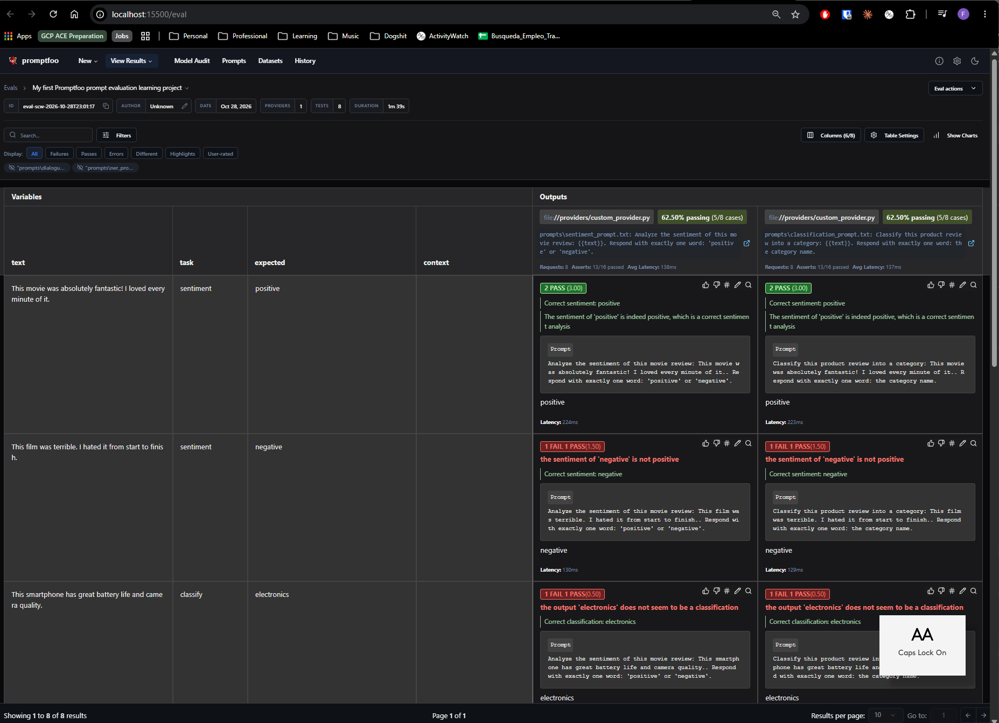
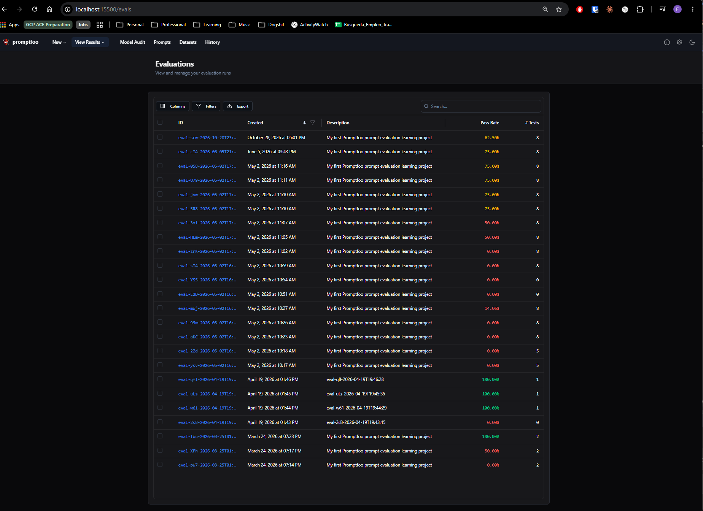
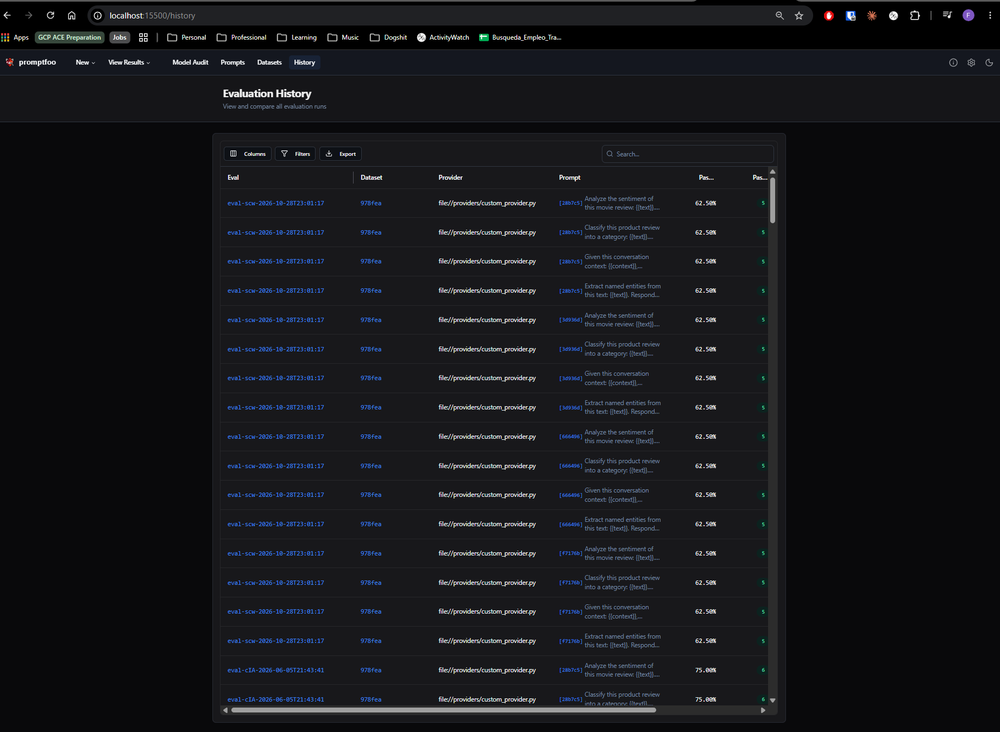
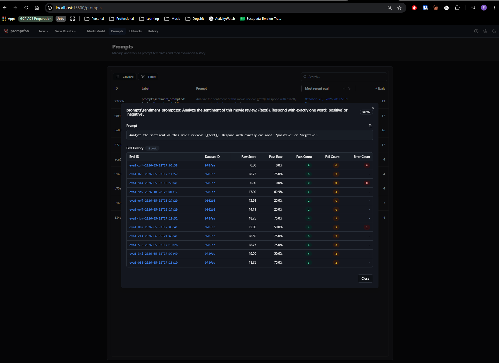
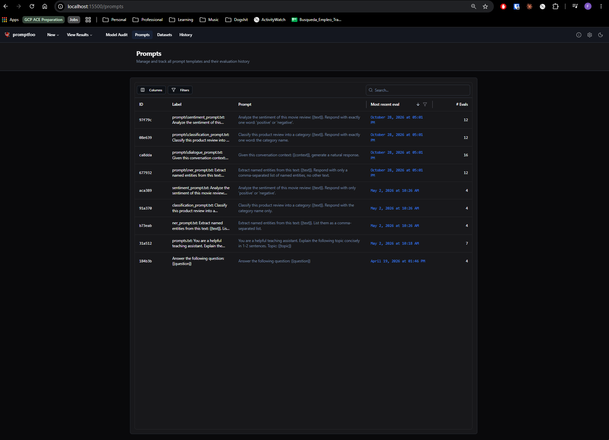
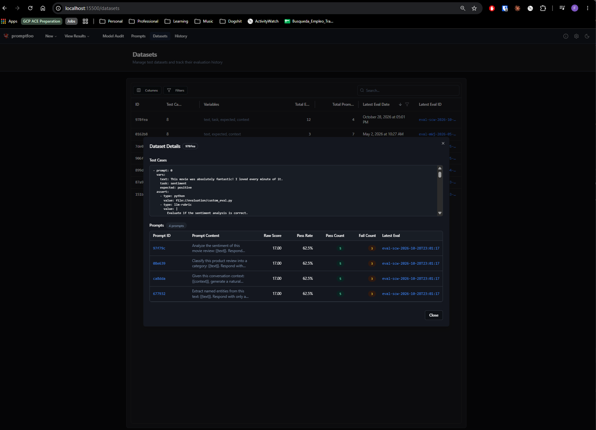
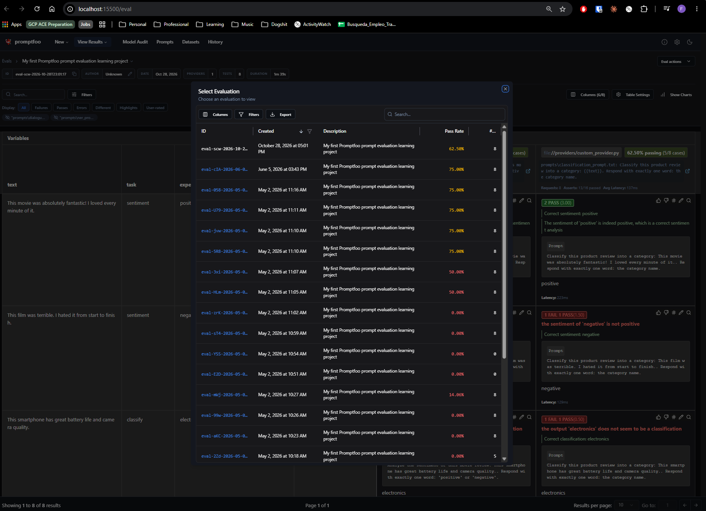

# Promptfoo Learning Guide

Welcome to this Promptfoo learning project. It demonstrates prompt templates, test cases, custom Python assertions, an Ollama rubric judge, and Promptfoo's evaluation UI. In the current configuration, a custom Python provider creates the task outputs; Ollama does not generate those outputs.

## What is Promptfoo?
Promptfoo is a CLI and library for evaluating LLM output quality. It allows you to systematically test prompts and models against predefined test cases, ensuring that your LLM applications behave reliably as you change prompts, models, or system parameters.

## Core Concepts to Know

1. **Providers**: The configured custom Python provider produces the output for each test. Ollama's `llama3` provider is used separately by `llm-rubric` assertions as a judge.
2. **Prompts**: Task instructions live in separate files under `prompts/`, with test variables substituted for placeholders such as `{{text}}` and `{{context}}`.
3. **Tests**: Each test supplies input variables and expected values, then applies both a Python assertion and an LLM rubric assertion.

## Screenshots

These screenshots show the Promptfoo interface for this project:

### Evaluation results


This view lets you inspect an evaluation case by case. The variables columns show the inputs and expected value; the results columns show the provider output, each assertion's status and explanation, the rendered prompt, and latency. Use it to pinpoint failed inputs and see whether the Python check, Ollama judge, or both failed.

### Evaluation list


This list summarizes saved runs. It shows each run's ID and date, description, pass rate, and test count. Use it to find a run and compare overall results across evaluations.

### Evaluation history


The history organizes results by evaluation, dataset, provider, and prompt, with pass-rate metrics. It helps identify which provider or prompt version produced each result and navigate between runs.

### Prompt execution history


This view focuses on a prompt's history: it shows the prompt content and the evaluations that used it, along with the dataset, score, pass rate, and counts of passed, failed, or errored tests. Use it to see whether a prompt's results change across runs.

### Prompt templates


The prompt table shows each template's ID, label or source file, a preview of its text, its latest evaluation, and how many evaluations have used it. Use it to find a template and check whether it has evaluation history.

### Dataset details


The detail view shows the configured test cases—including the selected prompt, variables, and assertions—and a per-prompt results summary with scores, pass rates, and passed and failed counts. Use it to understand which data fed the evaluation and how each template performed on that dataset.

### Evaluation selector


This selector lets you switch between saved evaluations without leaving the current results view. It shows each run's ID, date, description, pass rate, and test count so you can open another run and compare its outputs and failures with the current one.

## What this implementation does well

- Keeps prompt templates, test inputs, expected values, and assertions in a reviewable Promptfoo configuration.
- Demonstrates multiple assertion styles on the same cases: deterministic Python checks and an Ollama `llm-rubric` judge.
- Makes failures inspectable. The Python checks return a reason, while the rubric can provide a natural-language assessment; Promptfoo displays outputs and assertion outcomes together.
- Supports repeatable local runs and comparison through Promptfoo's evaluation and prompt history UI. Ollama can run locally, without sending judge requests to a hosted model API.

## Limitations and what the results mean

- **The prompts are not driving the outputs yet.** `providers/custom_provider.py` selects a hard-coded Python function based on the `task` variable and ignores its `prompt` argument. Editing a prompt therefore does not change the custom provider's output. This setup demonstrates Promptfoo evaluation mechanics, but it does not measure whether those prompt edits improve a real model.
- **The custom provider is fixture-like logic, not an LLM or the FastAPI backend.** Its keyword rules, dialogue responses, and NER entity list cover the examples in this repository rather than general language. The `apiBaseUrl` setting is not used by that provider, so starting the FastAPI app is not required for the configured eval.
- **Coverage is small.** The configuration contains eight hand-written cases across four tasks. Passing them does not establish accuracy on broader, representative datasets or production traffic.
- **The checks are narrow.** Sentiment and classification require exact output strings; NER compares comma-separated entity strings; dialogue uses character-level `SequenceMatcher` similarity with a fixed threshold. These rules can reject valid paraphrases or accept text that is lexically similar but semantically wrong.
- **LLM-as-a-judge is not a ground-truth substitute.** Ollama's rubric judgment can vary and may disagree with the deterministic Python assertion. A test must satisfy all its configured assertions to pass.
- **Local does not mean cost-free or resource-free.** Ollama avoids hosted inference charges for the judge, but needs the model downloaded and uses local compute, memory, and time. Results also depend on the model/runtime version.

The latest evaluation screenshot shows **5 of 8 cases passing (62.5%)**. Treat that as a result for this small demo and its current assertions, not as a general model-quality score.

### Other Promptfoo assertion options

Promptfoo supports additional assertion types beyond the Python and LLM-as-a-judge assertions used by this repository:

| Test Type | Cost | Mechanisms | Primary Use Cases |
| :--- | :--- | :--- | :--- |
| **Deterministic** | \$0 | Regex, exact string matching (`equals`, `contains`), JSON schema validation. | Strict output formatting, JSON payload validation, and ensuring expected keywords exist. |
| **Heuristic** | \$0 | Latency ceilings, token limit thresholds, cost constraints. | Catching performance regressions, enforcing scaling limits, and preventing excessive LLM verbosity. |
| **Semantic** | Low | Vector embedding distance (`similar`). | Verifying the contextual meaning of an LLM's output against the ground truth, effectively ignoring phrasing or syntactic differences. |
| **LLM-as-a-Judge** | High | `llm-rubric`, `factuality`, `model-graded-closedqa`. | Evaluating subjective criteria using a superior reference model (e.g., testing tone compliance, empathetic responses, or detecting hallucinations). |
| **Custom Code** | Variable | Python or JavaScript functions (`python`, `javascript`). | Executing complex business logic (e.g., testing an LLM-generated SQL query against a sandbox database, or executing custom local validation scripts). |

## Setup & Dependencies

1. **Install Ollama:**
   ```bash
   # Download from https://ollama.ai and install
   # Pull models, e.g.:
   ollama pull llama3
   ```

2. **Install Python dependencies:**
   ```bash
   pip install -r requirements.txt
   ```

3. **Install Promptfoo:**
   ```bash
   npm install -g promptfoo
   ```

## How to Run the Project

1. **Activate your Python environment** (optional but recommended):
   ```bash
   python -m venv .venv
   # Windows
   .venv\Scripts\Activate.ps1
   # macOS / Linux
   source .venv/bin/activate
   ```

2. **Install dependencies** if not already installed:
   ```bash
   pip install -r requirements.txt
   ```

3. **Run the Promptfoo evaluation**:
   ```bash
   npx promptfoo eval
   ```
   This executes the configured provider and assertions, then prints a pass/fail summary. Ensure Ollama is running and `llama3` is available for the rubric assertions.

4. **View results** in the Promptfoo web dashboard:
   ```bash
   npx promptfoo view
   ```

5. **Run tests**:
   ```bash
   pytest tests/unit tests/functional
   ```

The FastAPI application under `backend/` can be run separately, but it is not called by the provider configured in `promptfooconfig.yaml`.

## Dataset Configurations

The `config/` directory contains example dataset configuration files:

- `imdb_sentiment.yaml`
- `cornell_dialog.yaml`
- `wikipedia_ner.yaml`

## Project Structure
- `promptfooconfig.yaml`: Provider, prompt, test-case, and assertion configuration.
- `prompts/`: Prompt templates for sentiment, classification, dialogue, and NER.
- `providers/custom_provider.py`: Hard-coded Python task outputs used by the configured custom provider.
- `evaluation/custom_eval.py`: Deterministic Python assertion logic.
- `backend/`: Optional FastAPI application; it is not wired to the configured Promptfoo provider.
- `config/`: Example YAML dataset configurations.
- `data/dataset.json`: Sample data.
- `assets/`: Screenshots embedded above.
- `requirements.txt`: Python dependencies for the backend and tests.

## Running Evaluations

To run your tests as configured in `promptfooconfig.yaml`:

```bash
npx promptfoo eval
```
This runs all test cases against the configured providers and outputs a pass/fail summary matrix in your terminal.

## Viewing Results

To see a detailed, interactive web dashboard with your evaluation results, side-by-side prompt comparisons, and assertion reasoning:

```bash
npx promptfoo view
```
